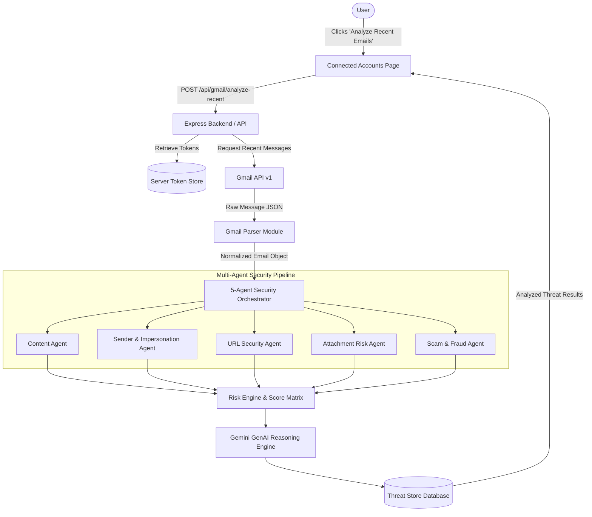

# Gmail API & Threat Analysis Pipeline Flow

This document details how real emails retrieved via the Gmail API are normalized and processed through MailGuard AI's Multi-Agent Security Orchestrator and Gemini Reasoning Engine.

---

## Threat Pipeline Flow Diagram

---

## Email Normalization Mapping
Raw Gmail messages (`gmail_v1.Schema$Message`) are converted into a standardized `NormalizedEmail` structure:

| Raw Gmail Field | Normalized Internal Field | Purpose |
|-----------------|--------------------------|---------|
| `id` / `threadId` | `messageId` / `threadId` | Unique message tracking |
| `headers.From` | `sender.name`, `sender.email`, `sender.domain` | Sender analysis & impersonation checks |
| `headers.Subject` | `subject` | Subject line sentiment & urgency parsing |
| `payload.parts` / `body` | `bodyText` / `bodyHtml` | Plaintext decoding and link extraction |
| Decoded Links | `urls[]` | Domain verification, IP detection, keyword checks |
| Decoded Attachments | `attachments[]` | File extension, script, and archive risk checks |

---

## Controlled Retrieval Rules
- **Batch Limit**: Manual analysis fetches a maximum of 5 recent emails by default.
- **No Mass Scanning**: MailGuard AI does not download or index the full user mailbox.
- **User Control**: Analysis is initiated manually by the user or via scheduled checks.
