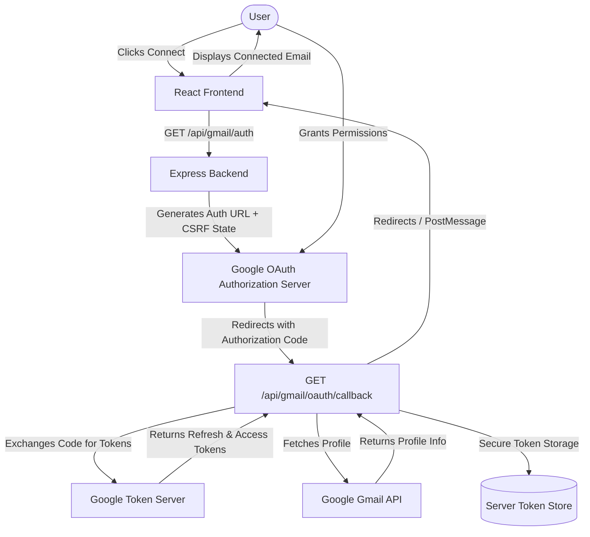

# Gmail OAuth 2.0 Security Architecture

MailGuard AI uses standard server-side Google OAuth 2.0 authorization to connect Gmail mailboxes securely without ever handling or requesting user passwords.

---

## High-Level Architecture Diagram

---

## Security Guarantees & Token Handling
1. **No Passwords Requested or Stored**: All authentication occurs directly on Google's domain (`accounts.google.com`).
2. **Server-Side Token Isolation**: Google OAuth access tokens and refresh tokens are stored exclusively on the backend server. Tokens are never exposed to client-side JavaScript or local browser storage.
3. **Least-Privilege Scopes**: Only `gmail.readonly` (for analysis) and `gmail.modify` (for user-approved threat labeling) are requested. Unrelated scopes (Drive, Contacts, Calendar) are explicitly excluded.
4. **CSRF State Validation**: Every authorization request generates a cryptographically unique state parameter that is validated upon OAuth callback execution.
5. **Session Revocation**: Clicking "Disconnect Gmail" clears stored tokens from server memory and resets the connection status immediately.
